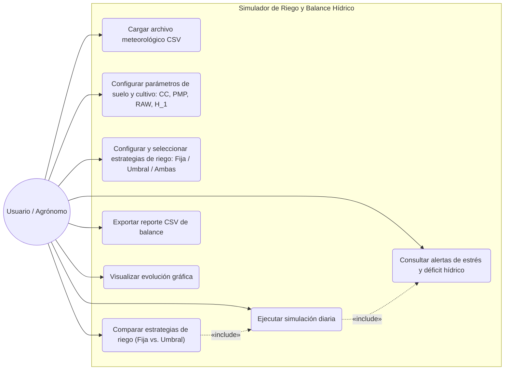
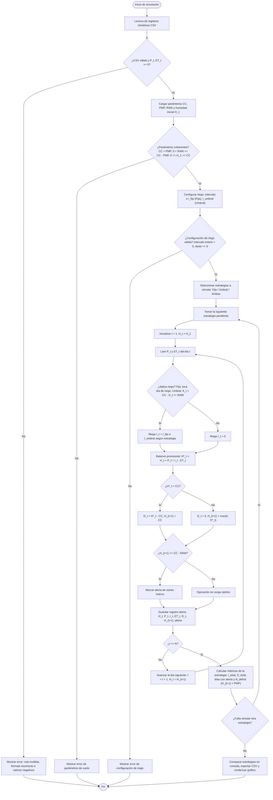

# Diagramas del Sistema - Proyecto 08

## Simulador de Riego y Balance Hídrico del Suelo

**Curso:** SW303 - Lenguaje de Programación I (Imperativo)  
**Responsable:** Diseñador de Flujos - Franco Herrera Rios

---

## 1. Propósito de los diagramas

Los diagramas describen cómo interactúa el usuario con el simulador y cómo fluye el proceso de cálculo día a día, desde la carga y validación de los datos hasta la comparación de estrategias y la generación de resultados.

El diagrama de casos de uso muestra las funciones que el sistema ofrece al usuario. El diagrama de flujo detalla el orden de las operaciones de la simulación: la validación de los datos de entrada, la decisión de riego, el balance hídrico, el drenaje por exceso, la alerta de estrés hídrico día a día y el cierre con las métricas comparativas y los reportes.

**Notación (idéntica a `02_modelo_matematico.md`):**

- $H_t$ es el agua almacenada al **inicio** del día $t$ y $H_{t+1}$ el agua al **final** de ese día (inicio del día siguiente). El almacenamiento inicial de la simulación es $H_1$.
- $H_{t+1} = \max(0,\ H_t^* - D_t)$, por lo que siempre se cumple $0 \le H_{t+1} \le CC$.
- $RAW$ es un parámetro del suelo/cultivo: cantidad de agua que se puede agotar desde $CC$ sin estrés.
- **Umbral de riego** (decisión del día $t$): $H_t \le CC - RAW$, equivalente a $A_t = CC - H_t \ge RAW$.
- **Alerta de estrés** (fin del día $t$): $H_{t+1} \le CC - RAW$.
- **Día con déficit** (fin del día $t$): $H_{t+1} < PMP$. Todo día con déficit es también día con alerta.

---

## 2. Diagramas del Sistema

### 2.1 Diagrama de Casos de Uso

### 2.2 Diagrama de Flujo del Proceso Diario de Simulación

