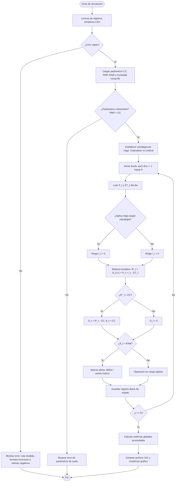

# Diagramas del Sistema - Proyecto 08

## Simulador de Riego y Balance Hídrico del Suelo

**Curso:** SW303 - Lenguaje de Programación I (Imperativo)  
**Responsable:** Diseñador de Flujos - Franco Herrera Rios

---

## 1. Propósito de los diagramas

Los diagramas describen cómo interactúa el usuario con el simulador y cómo fluye el proceso de cálculo día a día, desde la carga de los datos hasta la generación de resultados.

El diagrama de casos de uso muestra las funciones que el sistema ofrece al usuario. El diagrama de flujo detalla el orden de las operaciones de la simulación: la validación de los datos de entrada, la decisión de riego, el balance hídrico, el drenaje por exceso, la alerta de estrés hídrico y el cierre con las métricas y los reportes.

---

### 3.1 Diagrama de Casos de Uso

```mermaid
flowchart LR
    Actor(("Usuario / Agrónomo"))

    subgraph Sistema["Simulador de Riego y Balance Hídrico"]
        CU1("Cargar archivo meteorológico CSV")
        CU2("Configurar parámetros de suelo y cultivo")
        CU3("Seleccionar estrategia de riego: Fijo / Umbral")
        CU4("Ejecutar simulación diaria")
        CU5("Consultar alertas de déficit hídrico")
        CU6("Exportar reporte CSV de balance")
        CU7("Visualizar evolución gráfica")
    end

    Actor --> CU1
    Actor --> CU2
    Actor --> CU3
    Actor --> CU4
    Actor --> CU5
    Actor --> CU6
    Actor --> CU7

    CU4 -. "«include»" .-> CU5
```

### 3.2 Diagrama de Flujo del Proceso Diario de Simulación

